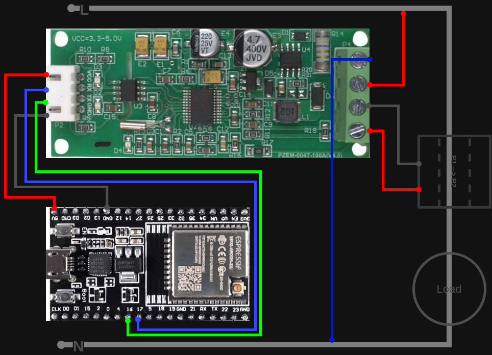
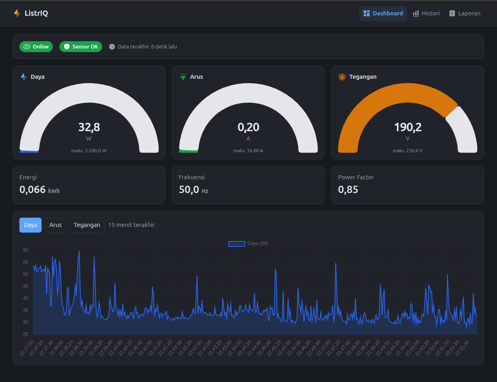

# Monitoring Listrik Rumah

Sistem monitoring listrik rumah berbasis PZEM-004T dan ESP32. Pembacaan tegangan, arus, daya, energi, frekuensi, serta faktor daya dikirim secara realtime ke dashboard web dan disimpan sebagai riwayat.

## Tampilan

### Image 1 - Identitas Sistem



Ilustrasi identitas/proyek ListrIQ untuk sistem pemantauan listrik rumah.

### Image 2 - Dashboard Monitoring



Dashboard menampilkan status perangkat, speedometer realtime untuk daya, arus, dan tegangan, grafik 15 menit terakhir, histori pembacaan, serta laporan energi harian dan bulanan.

## Arsitektur Aktif: MVP WiFi Langsung

```text
PZEM-004T + CT -> ESP32 WiFi -> MQTT (Mosquitto) -> Go backend -> TimescaleDB -> Vue dashboard
```

Mode yang berjalan saat ini memakai satu ESP32 untuk membaca PZEM-004T melalui UART2, kemudian mengirim data langsung melalui WiFi ke broker MQTT. Backend menerima data dari topik `powermon/<device_id>/data`, menyimpannya ke TimescaleDB, lalu mengirim pembaruan realtime ke dashboard lewat WebSocket.

Dashboard tersedia pada `http://<ip-server>:1077` dan broker MQTT pada port `1883`.

## Fitur

- Pembacaan realtime: tegangan, arus, daya, energi, frekuensi, faktor daya, dan status alarm PZEM.
- Speedometer dashboard untuk Daya (`0-3200 W`), Arus (`0-16 A`), dan Tegangan (`0-250 V`).
- Status online/offline perangkat dan status pembacaan sensor.
- Grafik pembacaan 15 menit terakhir melalui WebSocket.
- Halaman histori dengan resolusi raw, per jam, atau per hari.
- Laporan konsumsi energi dan daya puncak harian maupun bulanan.
- Penyimpanan data time-series menggunakan TimescaleDB.

## Kebutuhan

- Docker Engine dan Docker Compose untuk menjalankan layanan server.
- PlatformIO untuk membangun dan mengunggah firmware ESP32.
- ESP32 DevKitC V4, PZEM-004T v3 + CT, adaptor 5 V, dan enclosure yang sesuai.

Rencana anggaran perangkat tersedia di [`z_tmp/img/device.md`](z_tmp/img/device.md).

## Menjalankan Server

1. Buat konfigurasi database lokal dari template:

   ```bash
   cd deploy
   cp .env.example .env
   ```

2. Isi nilai `DB_PASSWORD` yang aman pada `deploy/.env`.

3. Bangun dan jalankan semua layanan:

   ```bash
   docker compose up -d --build
   ```

Perintah tersebut menjalankan Mosquitto, TimescaleDB, dan aplikasi Go yang sekaligus menyajikan hasil build frontend Vue.

## Konfigurasi Firmware WiFi

1. Salin template konfigurasi lokal:

   ```bash
   cp firmware/wifi-node/include/config.example.h firmware/wifi-node/include/config.h
   ```

2. Ubah `WIFI_SSID`, `WIFI_PASS`, dan `MQTT_HOST` pada `firmware/wifi-node/include/config.h`.

3. Hubungkan PZEM-004T v3 ke ESP32:

   | PZEM-004T | ESP32 |
   | --- | --- |
   | TX | GPIO16 (RX2) |
   | RX | GPIO17 (TX2) |
   | 5V | 5V |
   | GND | GND |

4. Bangun, unggah firmware, dan buka serial monitor:

   ```bash
   cd firmware/wifi-node
   pio run -t upload
   pio device monitor
   ```

`config.h` dan `deploy/.env` berisi konfigurasi lokal/rahasia dan telah diabaikan oleh Git. Jangan memasukkan kata sandi asli ke template atau dokumentasi.

> Peringatan keselamatan: PZEM-004T terhubung ke tegangan PLN. Matikan MCB sebelum memasang kabel, gunakan isolasi dan enclosure yang sesuai, serta gunakan teknisi listrik kompeten bila diperlukan.

## Pengembangan Lokal

Jalankan dependensi terlebih dahulu:

```bash
cd deploy
docker compose up -d mosquitto timescaledb
```

Pada terminal terpisah, jalankan backend dan frontend:

```bash
cd backend
DB_DSN=postgres://powermon:<DB_PASSWORD>@localhost:5432/powermon go run .
```

```bash
cd frontend
npm install
npm run dev
```

Vite mem-proxy `/api` dan `/ws` ke backend pada port `8080` saat mode pengembangan.

## Simulasi Data

Kirim pembacaan contoh tanpa perangkat fisik:

```bash
cd deploy
docker compose exec mosquitto mosquitto_pub -t powermon/main/data \
  -m '{"sensor_ok":true,"voltage":221,"current":2.1,"power":470,"energy":12.3,"frequency":50,"power_factor":0.98,"alarm":0,"seq":1}'
```

## Alternatif NRF24L01

Untuk panel listrik yang sulit dijangkau WiFi, proyek juga memiliki rancangan komunikasi radio: `Sensor Node (ESP32 + PZEM + NRF24L01) -> Gateway Node (ESP32 + NRF24L01) -> WiFi/MQTT`. Firmware terkait berada di `firmware/sensor-node` dan `firmware/gateway-node`. Jalur ini belum digunakan pada implementasi MVP WiFi langsung.

Dokumentasi rancangan lebih lengkap tersedia di [`z_tmp/planing/`](z_tmp/planing/).
